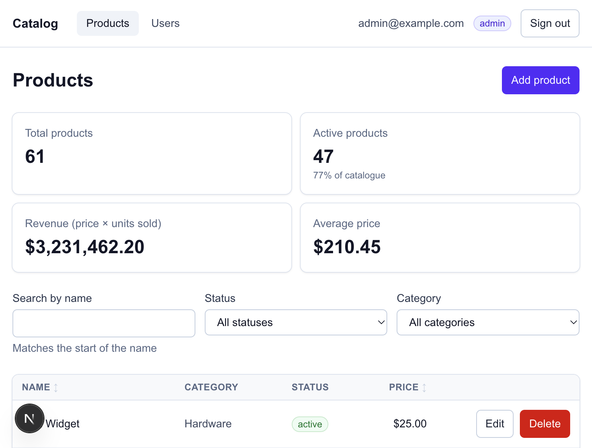
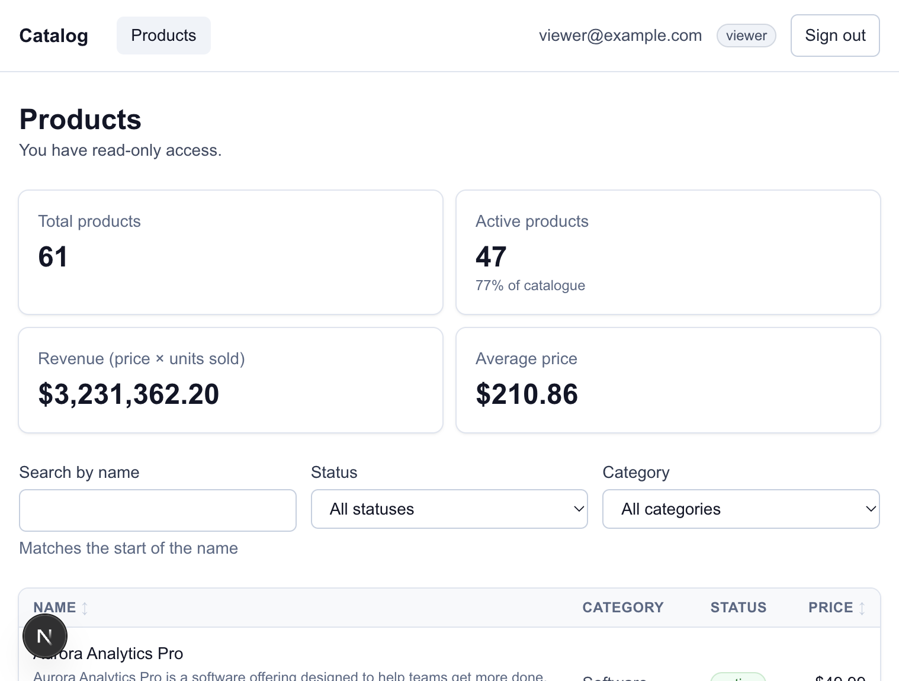
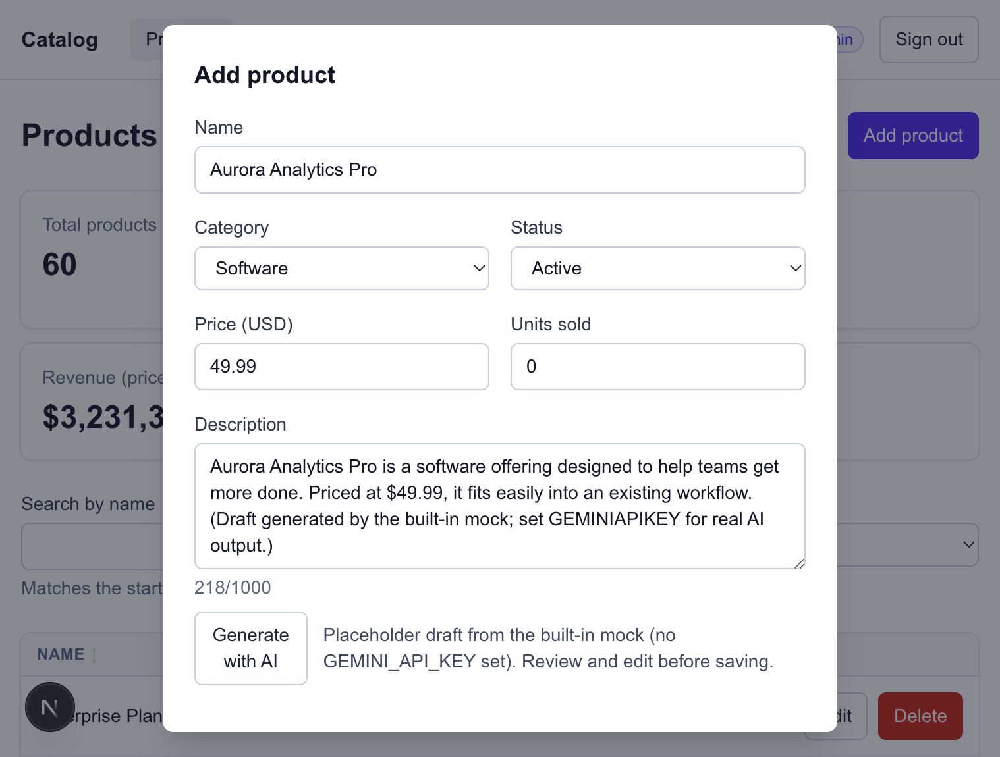
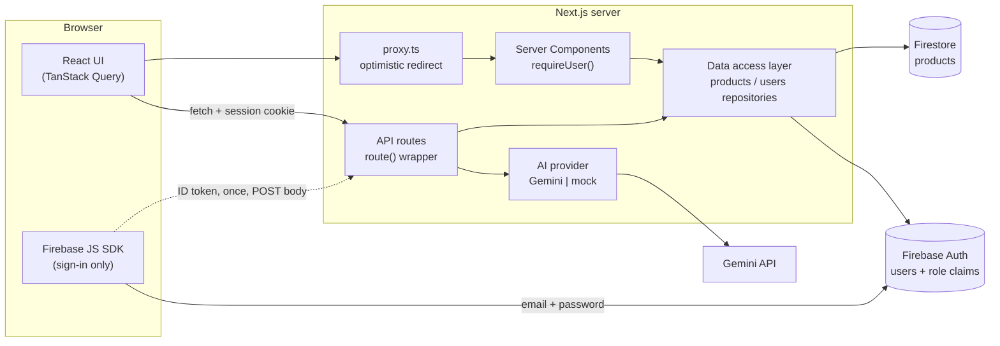

# Catalog: a mini SaaS product dashboard

A small product management dashboard built with **Next.js 16, Firebase Auth and Firestore**. Signed-in users manage products, see live summary metrics, and are limited by role: **admins** can create, edit and delete products (and draft descriptions with AI); **viewers** are read-only. The server enforces every rule; hiding buttons in the UI is a courtesy, not the control.

| Admin | Viewer (read-only) | AI-drafted description |
|---|---|---|
|  |  |  |

**What is in the box**

- Firebase email/password sign-up and sign-in, exchanged for an httpOnly session cookie; two roles, enforced on the server.
- Product create, read, update, delete (Firestore, via a data access layer behind Next.js API routes), plus recording sales, each at the price it sold for.
- Dashboard: four metrics, filter by status and category, sortable columns, search by name, cursor-based "Load more", responsive layout, accessible markup.
- Admin-only Users page to promote or demote people, which also revokes their sessions.
- **Bonus: AI-generated product descriptions** (Gemini, with a mock fallback), with notes on productionising it safely.
- 127 automated tests: unit, emulator integration, and end-to-end over HTTP.

Everything runs **locally against the Firebase emulators, with no Firebase project, no API keys and no secrets.**

---

## 1. Setup (about 5 minutes)

**You need:** Node.js 22.18 or newer, and a Java runtime (the Firebase emulators are Java programs; I used Java 21 and have not tried older versions). I developed on Node 26 and have not run it on 22.

```bash
npm install
cp .env.example .env.local     # defaults already point at the local emulators

# terminal 1: Auth + Firestore emulators (UI at http://localhost:4000)
npm run emulators

# terminal 2
npm run seed                   # 2 demo users + 60 demo bakery products
npm run dev                    # http://localhost:3000
```

Sign in with:

| Account | Password | Role |
|---|---|---|
| `admin@example.com` | `Passw0rd!demo` | admin: full access |
| `viewer@example.com` | `Passw0rd!demo` | viewer: read-only |

Or create your own account on the sign-up form. You must verify the email before you can sign in: the Auth emulator does not send real mail, it prints the verification link in terminal 1. New accounts are viewers; promote them from **Users** while signed in as admin.

If `java` is not on your path on macOS: `brew install openjdk` (or point `JAVA_HOME` at any JDK, for example the one bundled with Android Studio).

### Other commands

| Command | What it does |
|---|---|
| `npm test` | 83 unit tests, no services needed. |
| `npm run test:integration` | 13 tests of the real data layer against a throwaway emulator. Starts and stops the emulators itself. |
| `npm run test:e2e` | 21 HTTP tests of auth and roles. Needs the emulators, the seed and `npm run dev` running. |
| `npm run lint` / `npm run typecheck` / `npm run build` | Static checks and a production build. |
| `npm run set-role -- you@example.com admin` | Set a role from the command line (how the **first** admin is made). |
| `npm run indexes:generate` | Regenerate `firestore.indexes.json` from the query code. |

### Optional: real Gemini output

Put a key in `.env.local` (`GEMINI_API_KEY=...`). Without one, the AI button returns a clearly labelled placeholder from a built-in mock, so the feature is demonstrable offline.

### Optional: a real Firebase project

1. Create a project, enable **Authentication > Email/Password**, create a Firestore database.
2. Fill the `NEXT_PUBLIC_FIREBASE_*` values from the web app config; set `NEXT_PUBLIC_USE_EMULATORS=false`; **delete** the two `*_EMULATOR_HOST` lines; add a service account as `FIREBASE_CLIENT_EMAIL` and `FIREBASE_PRIVATE_KEY`.
3. `firebase deploy --only firestore:rules,firestore:indexes`
4. Sign up in the app, then `npm run set-role -- you@example.com admin`.

I have **not** run the app against a real Firebase project; see [Limitations](#9-known-limitations-and-what-i-did-not-verify).

---

## 2. Architecture



### Layers, and why they are separate

| Layer | Where | Responsibility | Knows about |
|---|---|---|---|
| UI | `components/`, `hooks/`, `app/**/page.tsx` | Rendering, forms, client state. | The API only (via `lib/api/client.ts`). Never Firestore. |
| Route wrapper | `lib/api/handler.ts` | On **every** call: origin check, session check, role check, error mapping, request id, no-store, one log line. | Auth, roles. |
| Routes | `app/api/**/route.ts` | Parse input (zod), call the data layer, return JSON. Each is a few lines. | Wrapper, repositories. |
| Data access layer | `lib/products/repository.ts`, `lib/users/repository.ts` | The **only** code that touches Firestore or the Auth admin API. | Firestore document shape. |
| Query plan | `lib/products/queryPlan.ts` | Pure description of which Firestore query a request becomes, and which indexes that needs. | Nothing external; unit-testable. |
| Shared contracts | `lib/products/schema.ts`, `lib/auth/roles.ts` | zod schemas, the `can(role, permission)` map. Used by both browser and server. | Nothing. |
| AI | `lib/ai/` | A provider interface with Gemini and mock implementations, prompt, sanitiser, rate limiter. | Nothing app-specific. |

Decisions I would defend in a walkthrough:

- **One data access layer, no Firestore in components or routes.** Derived fields (`nameLower`, and the `unitsSold` / `revenueCents` sales totals) are computed in exactly one place, so they cannot go stale.
- **Next.js API routes rather than a separate service.** One deployable and one language is the right size for this scope. The repository boundary means the data layer could be lifted into its own service without touching the UI.
- **Shared zod schema and one permission map.** The form and the API validate with the same rules, and the UI and the server answer "can this role do that?" with the same function.
- **`route()` wrapper instead of per-route boilerplate.** A new endpoint cannot forget the CSRF check, the auth check or error mapping, because it does not write them.
- **TanStack Query for server state**, plain `useState` for form and filter state. `useInfiniteQuery` maps directly onto cursor pagination, and one `invalidateQueries` after a write refreshes both list and metrics.
- **AI behind an interface.** Tests and offline reviewers use the mock; swapping vendors is one file.

```
src/
  app/            routes: pages (login, dashboard, admin/users) and api/
  components/     UI (Dashboard, ProductTable, ProductDialog, Modal, ...)
  hooks/          useProducts (queries + mutations), useDebouncedValue
  lib/
    api/          route wrapper, error types, browser fetch client
    auth/         roles + permissions, session cookie, guards
    firebase/     admin (server) and client (browser) init
    products/     schema, repository, query plan, cursor codec
    users/        user admin (Auth custom claims)
    ai/           provider interface, Gemini, mock, prompt, sanitiser, rate limit
  proxy.ts        optimistic signed-out redirect
scripts/          seed, set-role, generate-indexes
tests/            unit + integration/ + e2e/
docs/DATABASE.md  full schema, index and scaling write-up
```

---

## 3. Database schema

Two Firestore collections, `products` and `sales`. Users and roles live in Firebase Auth as a custom claim.

`products/{id}`:

| Field | Type | Set by |
|---|---|---|
| `name`, `category`, `status`, `description` | string / enum | client |
| `priceCents` | integer (cents, never floats) | client |
| `nameLower` | string (denormalised) | server |
| `unitsSold`, `revenueCents` | integer (running totals of the product's sales) | server |
| `createdAt`, `updatedAt`, `createdBy`, `updatedBy` | Timestamp, uid | server |

`sales/{id}`: `productId`, `quantity`, `unitPriceCents` (the price **at the time of sale**), `amountCents`, `createdAt`, `createdBy`. All set by the server; sales are never edited.

Highlights (the full write-up is in **[docs/DATABASE.md](docs/DATABASE.md)**):

- **Indexes:** 18 composite indexes cover every filter, sort and search combination the UI offers. The file is **generated from the query code and checked by tests**, because the emulator does not enforce indexes and a gap would only appear in production. Never-queried fields have their automatic indexes turned off to cut write cost.
- **Metrics use Firestore aggregation queries** (`count`, `sum`, `average`), so the dashboard never reads the whole collection. Revenue is `sum(amountCents)` over `sales`, so a price change never restates past revenue and a deleted product's sales still count.
- **Pagination is cursor-based** (`startAfter(value, id)`): constant cost per page at any depth, stable with ties.
- **Multi-tenancy:** nest under `orgs/{orgId}/products`, take `orgId` from the verified session, keep rules deny-all.
- **10x:** list reads are already bounded; the first things to change are metrics (maintained counters) and search (an external index). Both are spelled out with triggers in the doc.

---

## 4. Security decisions

### Sign-in and session, end to end

1. The browser signs in with the Firebase SDK (email + password). The SDK is configured with **in-memory persistence**, so no token is left in `localStorage` or IndexedDB where XSS could read it.
2. The browser sends the short-lived ID token **once, in a POST body** (never a URL) to `POST /api/auth/session`.
3. The server verifies it with the Admin SDK (`checkRevoked: true`), requires that the sign-in happened in the **last 5 minutes** (Firebase's guidance for minting a session), requires a **verified email address**, and creates a **session cookie**. Sign-up is open, so without the verification check anyone could register someone else's address (for example the CEO's) and look trustworthy on the Users page. Sign-up sends the verification link; signing in unverified re-sends it.
4. The cookie is **`HttpOnly`** (JavaScript cannot read it), **`Secure`** in production, **`SameSite=Lax`**, scoped to `/`, expiring in 5 days. The browser then discards its Firebase session.
5. On every request the server verifies the cookie with `checkRevoked: true`. Forged, expired, revoked and disabled-user cookies are all rejected.
6. Sign-out **revokes the session in Firebase** (`revokeRefreshTokens`) and then clears the cookie, so a copied cookie stops working too. Firebase revokes per user, so this signs the user out on every device. A 401 from the API sends the browser to `/login` with a full page load, which also discards cached data.

### Roles

- Roles are **custom claims** on the Firebase user (`role: "admin"`). Only the Admin SDK can set them, so a client cannot grant itself a role.
- **Missing, misspelled or malformed claim means `viewer`** (`parseRole`). The default fails towards least privilege, and only admins need to be stored.
- A single `can(role, permission)` map (`product:read`, `product:write`, `ai:generate`, `user:manage`) is used by the UI to hide controls **and** by the server to enforce them.
- Changing someone's role calls `setCustomUserClaims` and then `revokeRefreshTokens`. Because sessions are verified with `checkRevoked`, a demoted admin's very next request fails and they must sign in again. Without this, a demoted admin would keep admin rights until the cookie expired.
- An admin cannot change **their own** role, so the last admin cannot lock themselves out.
- The first admin is created from the command line (`npm run set-role`), not through the app.

### Where checks happen (defence in depth)

| Layer | Check | Purpose |
|---|---|---|
| `proxy.ts` | Session cookie *exists* | Fast redirect for signed-out visitors. **Not a security boundary**: a forged cookie passes it. |
| Server Components | `requireUser()` verifies the cookie with Firebase; the Users page also checks `can(role, "user:manage")` | Pages are protected, and non-admins never receive the Users page. |
| `route()` wrapper | Origin check, verified session, role check | Every API call. Role checks are declared per route (`permission: "product:write"`) and enforced before the handler runs. |
| Zod, `strictObject` | Reject unknown fields, bad types, out-of-range values | Clients cannot set `createdBy`, `unitsSold`, `revenueCents`, a sale's price, ids, or negative prices. |
| `firestore.rules` | `allow read, write: if false` | Even a leaked web API key cannot touch data; only the server (Admin SDK) can. |

### OWASP-style checklist

| Concern | What the code does |
|---|---|
| Sensitive data in URLs | ID token travels in a POST body; the session is a cookie. Pagination cursors are the only opaque values in URLs and grant nothing. |
| Session handling | httpOnly, Secure (prod), SameSite=Lax, 5-day expiry, verified email required, server-side revocation on sign-out and on role change. |
| CSRF | SameSite=Lax **plus** an Origin check on every non-GET request (missing or foreign Origin gives 403). |
| Injection | zod validation everywhere; Firestore queries are built from validated enums and typed values, never from strings. The route id is validated to be alphanumeric before it reaches Firestore. |
| Broken access control | Server-enforced roles, tested over real HTTP including "viewer tries every write", "viewer calls admin endpoints" and "old session after role change". |
| Information leakage | Unexpected errors return a generic 500 with a request id; the stack trace goes to the log only. Login says "incorrect email or password" for both unknown user and wrong password. Responses are `Cache-Control: no-store`. |
| Security headers | `X-Content-Type-Options`, `X-Frame-Options: DENY`, `Referrer-Policy`, `Permissions-Policy`, `Strict-Transport-Security`. |
| Secrets | Server keys live only in environment variables; `.env*` is git-ignored except `.env.example`, which holds emulator-only values. The Gemini key never reaches the browser. |

**Not done, deliberately listed:** a strict Content-Security-Policy (needs per-request nonces with Next), rate limiting on sign-in (Firebase has its own throttling), MFA, and App Check. See [What's next](#8-whats-next).

---

## 5. AI feature: generated product descriptions

**What it does.** In the product form, an admin clicks **Generate with AI**. The server sends the product name, category and price to Gemini and puts the result in the description box as an editable draft. Nothing is saved until the admin saves the product.

**How it works.** `POST /api/ai/description` (admin only) → rate limiter → `DescriptionProvider` (`GeminiProvider` if `GEMINI_API_KEY` is set, otherwise `MockProvider`) → `sanitizeDescription` → JSON. Gemini is called with plain `fetch` (one endpoint, no SDK), the key in a header, a 10-second timeout, one retry on 429/5xx, and `maxOutputTokens` capped.

**Safety measures that are built and tested**

- **Admin-only and rate-limited** (10 per user per minute), so a signed-up stranger cannot spend your quota.
- **Key stays on the server.**
- **Prompt injection:** fixed instructions are in the system role; the product name is passed as a JSON value and the model is told to treat values as data. A test shows a hostile name cannot break out of its JSON string. This lowers the risk but cannot remove it, so the real safeguards are the next two points.
- **Output is untrusted:** control characters, markdown and links are stripped, length is capped at 500 characters, and empty output is an error. It is rendered as plain text (React escapes it).
- **Human in the loop:** the text is a draft in a form field. Nothing is published without an admin pressing save.
- **Graceful failure:** a timeout or provider error shows a message; the form keeps working.
- **No sensitive logging:** logs record status and latency, never prompts or responses.

**How I would productionise it (not built)**

- **Shared, durable rate limits and a daily spend cap**: the in-memory limiter only protects one server instance. Use Redis or Firestore counters, plus a provider-side budget alert.
- **Cost and quality telemetry**: log token usage, latency and error rate per call (no content) and alert on spikes.
- **Evaluation set**: a few dozen products with checks for length, tone and "no links or claims", run before changing the model or prompt.
- **Moderation**: enable the provider's safety settings and treat a blocked response as a normal, user-visible error.
- **Data handling**: confirm the provider's data-retention terms before sending anything beyond catalogue fields; never send user PII.
- **Async path** if drafts ever become slow or bulk: a queue and a job record instead of a request that waits on the model.

I could not call the real Gemini API in development (no key), so `GeminiProvider` is **untested against the live service**. The request shape follows the public REST documentation. Everything around it (route, auth, rate limit, sanitiser, UI) is tested with the mock.

---

## 6. Testing

| Suite | Count | Covers |
|---|---|---|
| Unit (`npm test`) | 88 | Role parsing and permissions; zod schemas (defaults, strictness, bounds); cents parsing; cursor round-trip and tampering; query plan and index consistency; AI sanitiser, prompt and rate limiter; CSRF origin check. |
| Integration (`npm run test:integration`) | 18 | The real repository on the Firestore emulator: CRUD, derived fields, sales at the price of the moment, concurrent sales, paging through ties in every sort and direction, filters, search, malformed cursors, aggregation metrics including deleted products' revenue. |
| End-to-end (`npm run test:e2e`) | 21 | The running app over HTTP: 401 without a session, forged cookies, cookie flags, unverified emails refused, default role for new sign-ups, **session revoked on sign-out**, **viewer is refused every write and admin endpoint**, admin CRUD, validation, cursor paging, CSRF rejection, AI endpoint and rate limit, **session revoked after a role change**, signed-out redirects, security headers. |

Two things I did to trust the tests: I deliberately broke `parseRole` and then the `product:write` permission on one route, and confirmed the relevant tests failed. I also exercised the UI in a browser as both roles (sign-in errors, create, delete, search, AI draft, responsive checks at 375 px and 1024 px).

**Not covered:** there are no component or browser-automation tests (the UI was checked by hand), no real-Firebase run, and no load testing.

---

## 7. Trade-offs and scope decisions

| Decision | Why | Cost |
|---|---|---|
| Next.js API routes, not a separate Node service | One deployable, shared types and schemas; fits a 2-3 day scope. | Data layer shares a process with the web app. The repository boundary makes extraction easy. |
| Role in custom claims, no `users` collection | One source of truth. | Listing users uses the Auth API (capped at 100 here); no queryable profile data. |
| `checkRevoked` on every request | Role changes and disabled accounts take effect immediately. | One extra Auth lookup per request. A role cache would trade immediacy for speed. |
| Session cookie, not storing ID tokens in the browser | XSS cannot steal the session. | Needs a server round-trip to sign in. |
| Price as integer cents; a `sales` collection | Exact arithmetic; "revenue" is the sum of real sales at the price each sold for, so price edits and deletes never restate it. | The brief did not ask for sales, so this is my interpretation of "revenue total". No refunds yet: those need a "void sale" that reverses a specific sale. |
| Denormalised `nameLower`, `unitsSold`, `revenueCents` | Search, name sort and per-product totals without extra reads. | Must only be written through the repository, in the same transaction as the sale. |
| Prefix search, not full-text | Native Firestore, no extra service. | "pro" does not match "Aurora Analytics Pro"; search forces name sort. |
| Fixed category list in code | Simple filters, no distinct-query problem (Firestore has none). | Changing categories is a code change. |
| Hard delete | Simple. | No undo or history. `inactive` status covers "hide it". |
| "Load more" rather than numbered pages | The honest shape of cursor pagination. | No jump-to-page and no total page count. |
| In-memory AI rate limiter | No extra infrastructure. | Per instance only. |
| Skipped: CI workflow, deployment, structured-log shipping | I chose AI as my bonus area and wanted one thing done well. | No pipeline; no hosted demo. A one-line request log exists but nothing consumes it. |
| No Next.js `cacheComponents` | The app is per-user, request-time data; caching adds ceremony and no benefit. | None here. |
| Replaced `next/font` with a system font stack | Builds without network access. | Slightly less distinctive typography. |

---

## 8. What's next

If I had another week, in this order:

1. **Run it against a real Firebase project and deploy** (Vercel or Firebase App Hosting). This is the biggest unverified area, especially that the generated indexes are accepted and sufficient.
2. **CI**: GitHub Actions running lint, typecheck, unit tests, and integration tests (emulators) on every push, plus the e2e suite against a built app.
3. **Security hardening**: a nonce-based Content-Security-Policy, sign-in rate limiting and App Check, MFA for admins, and an audit log (who changed which product or role).
4. **Production AI**: shared rate limits and spend cap, usage telemetry, evaluation set, moderation settings (see section 5).
5. **Multi-tenancy** as sketched in `docs/DATABASE.md`.
6. **Search**: sync to Typesense or Algolia for real full-text search, removing the "search forces name sort" restriction.
7. **Frontend polish and tests**: Playwright for the main flows, optimistic updates, filters kept in the URL so views are shareable, bulk actions, product images, and a proper design-system pass.
8. **Observability**: ship the structured logs, add tracing and error reporting (Sentry), and dashboards for latency and AI cost.

---

## 9. Known limitations and what I did not verify

- **Never run against real Firebase or the live Gemini API.** All of it ran against the emulators and the mock.
- **Firestore indexes are not validated by the emulator.** The tests prove that the committed file matches what the code queries, not that Firestore accepts it.
- **Node:** developed and tested on Node 26. `engines` declares 22.18+ (the version where Node runs TypeScript scripts without a flag), which I did not test.
- **Sessions last 5 days** and a role change signs the user out on their next request, not instantly in an open tab.
- **A fresh sign-in and a role change in the same second:** Firebase revocation has one-second granularity, so a session created in the same second as a revocation is not rejected. Negligible in practice; the e2e test waits a second to avoid it.
- **Users page** lists the first 100 users only.
- **Emulator demo credentials** are published in this README and shown on the login page when `NEXT_PUBLIC_USE_EMULATORS=true`. The seed script refuses to run unless the emulators are configured.
- **Dev-mode warnings:** Next.js 16 is new; I did not chase every dev-only message.

---

## 10. Tools, frameworks and AI usage

### Frameworks and libraries (and how each is used)

| Library | Used for |
|---|---|
| **Next.js 16** (App Router) | UI, API routes, server-rendered auth checks, `proxy.ts` for the optimistic redirect. |
| **React 19** | UI. |
| **Tailwind CSS 4** | Styling. Small shared primitives in `components/ui.tsx`. |
| **Firebase Auth** (client SDK) | Email/password sign-in in the browser only. |
| **firebase-admin** | Verifying tokens, session cookies, custom claims, and all Firestore access on the server. |
| **Firebase emulators** (`firebase-tools`) | Local Auth and Firestore, so no project is needed. |
| **zod 4** | Validation shared by browser and server. |
| **TanStack Query 5** | Server state, infinite (cursor) list, cache invalidation after writes. |
| **Vitest 5** | All three test suites. |
| Native `<dialog>` | Modals (focus trap, Escape, inert background for free). |

No UI component library: the interface is small, and I wanted every line of markup to be explainable and accessible by construction.

### AI tool usage

I built this with **Cursor's AI coding agent (Claude)** working in my repository, and used it for most of the implementation: scaffolding, the route wrapper and data layer, the query-plan and index generation, the UI components, and the test suites. My own contribution was scope and direction: choosing AI as the bonus area and the product-description feature, adding the Users admin page, requiring cursor-based pagination, and deciding what to cut.

What I did to own the output rather than just accept it:

- Read the Next.js 16 docs bundled in `node_modules/next/dist/docs` before writing anything, because this version differs from what the model knew (for example `proxy.ts` replaces `middleware.ts`, and `cacheComponents` is on by default in the scaffold).
- Verified behaviour instead of trusting it: 116 automated tests, two deliberate "break it and watch the test fail" checks, and a manual pass through the UI as both roles. That pass found two real bugs the tests had not: the AI sanitiser was stripping underscores from text (`GEMINI_API_KEY` became `GEMINIAPIKEY`), and a name search inherited the "newest first" direction and showed results Z-to-A. Both are fixed and the first has a regression test.
- Kept the code small enough to explain: no component library, no SDK for Gemini, one wrapper for cross-cutting API concerns.

I can walk through any file; the places most worth discussing are `lib/api/handler.ts` (the security perimeter), `lib/products/repository.ts` and `queryPlan.ts` (Firestore constraints and indexes), and `lib/auth/session.ts` (session lifecycle).
